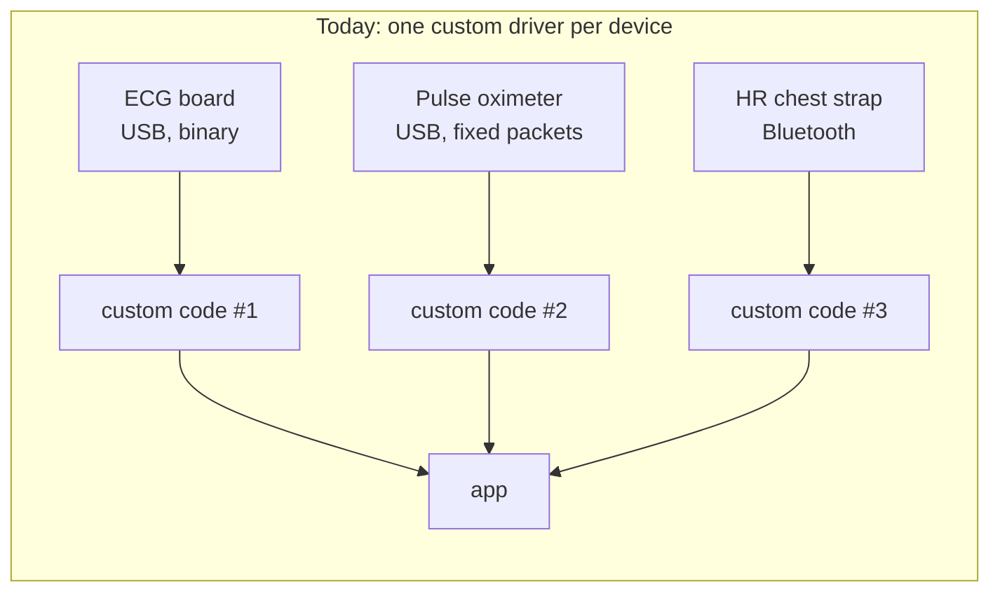
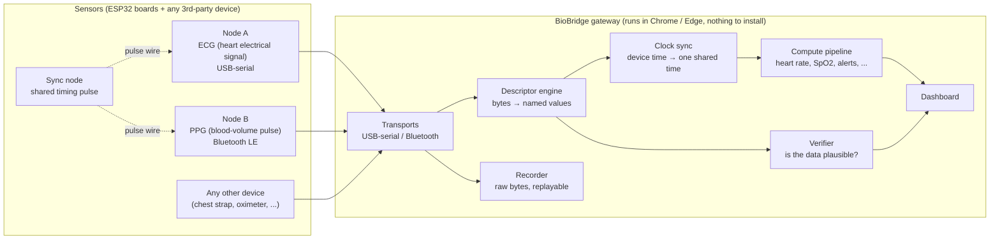
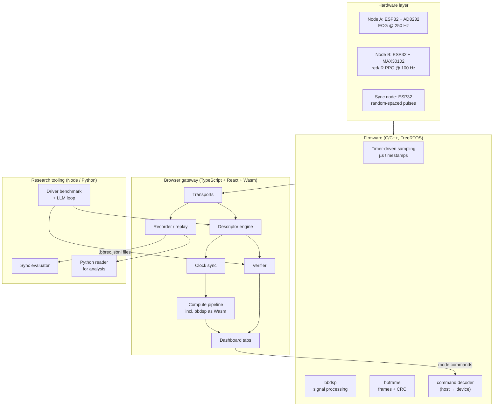
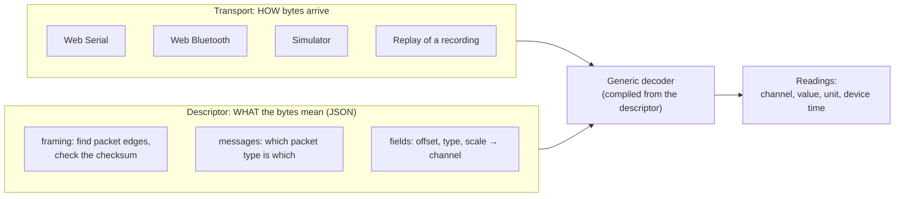
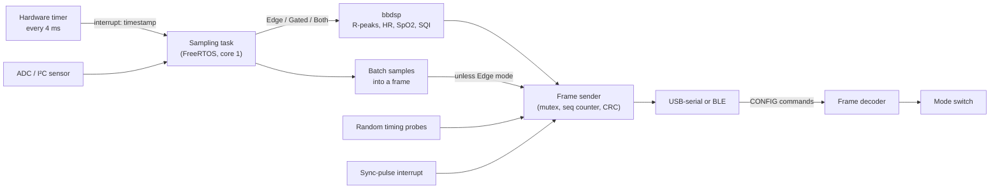
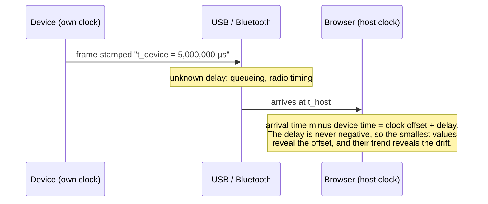
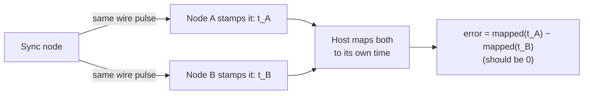
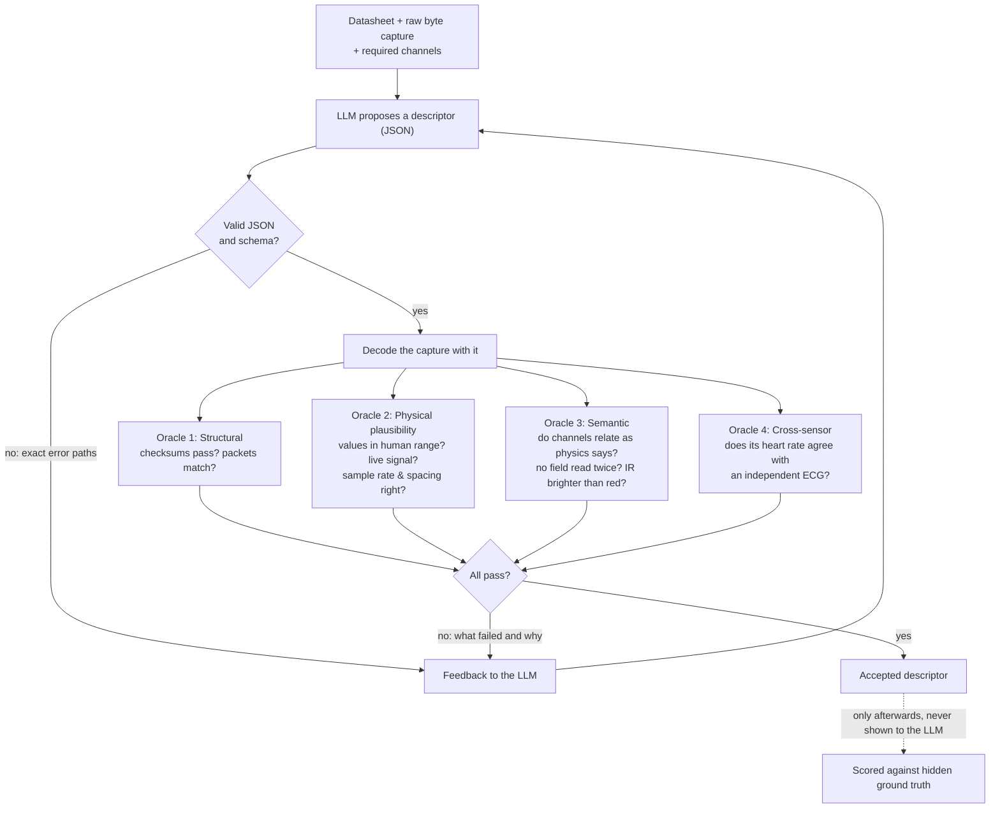
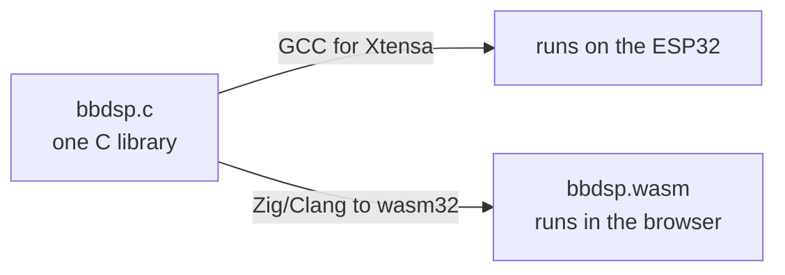

# BioBridge

**One gateway for many medical sensors: connect any device, read its data correctly, keep every device on the same clock, and decide where the computing happens.**

BioBridge combines embedded firmware (ESP32), a browser-based gateway (TypeScript/React, WebAssembly), a shared signal-processing library in C, and two research directions.

> ⚠️ **Research prototype, not a medical device.** Nothing here is for diagnosis or treatment. Values like SpO2 use uncalibrated textbook formulas. When recording ECG from a person, power the laptop from its battery, not from the mains.

---

## Contents

1. [The problem in plain words](#1-the-problem-in-plain-words)
2. [What BioBridge does](#2-what-biobridge-does)
3. [Concepts you may not know](#3-concepts-you-may-not-know)
4. [System architecture](#4-system-architecture)
5. [Key ideas, one at a time](#5-key-ideas-one-at-a-time)
6. [Repository layout](#6-repository-layout)
7. [Getting started](#7-getting-started)
8. [Testing and how we check our work](#8-testing-and-how-we-check-our-work)
9. [Project status](#9-project-status)
10. [Future scope](#10-future-scope)
11. [Skills this project exercises](#11-skills-this-project-exercises)
12. [Team and acknowledgements](#12-team-and-acknowledgements)

---

## 1. The problem in plain words

Cheap medical sensors are everywhere: chest straps that measure heart rate, fingertip clips that measure blood oxygen, small boards that record an ECG. But **every one of them speaks its own language**:

- one sends text over a USB cable, another sends binary packets over Bluetooth;
- one is big-endian, another little-endian; one checks for errors with a CRC, another with a simple sum;
- each has its own idea of what time it is.

So every time a lab, a hospital or a student wants to use a new device, someone has to write a new piece of software (a *driver*) by hand. When several devices are used together, their timestamps don't line up. On top of that, nobody has a principled answer to a basic design question: *should the computing happen on the tiny sensor, or on the computer it talks to?*



The questions this project answers:

| Question | Our answer, in one line |
|---|---|
| How do we connect a new device without writing a new driver? | Describe its data format in a short JSON file (a **descriptor**); one generic engine reads them all. |
| Can an AI write that description from the device's manual? | Yes, with a **verifier** that checks the AI's answer against real data, so it can be trusted. *(Research direction 2)* |
| How do we line up data from devices with different clocks? | Estimate each device's clock offset and drift online, using what we know about USB and Bluetooth timing. *(Research direction 1)* |
| Where should the signal processing run, on the sensor or the computer? | Both, with the **same code**, switchable at runtime, and measured. |

---

## 2. What BioBridge does



In one sentence: **sensors stream raw bytes; the browser turns them into trustworthy, time-aligned, processed measurements, and can push processing back onto the sensor when that saves energy.**

The app runs entirely in the browser. It uses the **Web Serial** and **Web Bluetooth** APIs to talk to hardware directly, so there is no server, nothing to install, and data never leaves the machine. Every feature also works with **simulated devices**, which produce exactly the bytes the real firmware would, so you can try everything without hardware.

---

## 3. Concepts you may not know

You don't need a medical or embedded background to follow this project. Here are the terms used throughout.

### Body signals

| Term | What it is | Picture it as |
|---|---|---|
| **ECG** (electrocardiogram) | The heart's electrical activity, picked up by electrodes on the skin. Each heartbeat makes a sharp spike called the **R-peak**. | The spiky line on a hospital monitor. |
| **PPG** (photoplethysmogram) | Light shone into the skin (usually a fingertip). Blood absorbs light, so each pulse of blood slightly dims the reflected light. | The wave from a smartwatch's green or red light. |
| **Heart rate / pulse rate** | Beats per minute, measured from the gaps between R-peaks (ECG) or pulses (PPG). | — |
| **SpO2** | Blood oxygen saturation (%), estimated by comparing how red and infrared light pulse. | The number a fingertip oximeter shows. |
| **PTT** (pulse transit time) | Time from the heart's beat (ECG R-peak) until the pulse reaches the finger (PPG), ~150–300 ms. It is linked to blood pressure, which is why accurate *cross-device* timing matters. | Lightning (ECG) followed by thunder (PPG). |
| **SQI** (signal quality index) | A 0–1 score of how clean a signal is. Motion and loose contact lower it. | — |

### Hardware and communication

| Term | What it is |
|---|---|
| **ESP32** | A cheap microcontroller with Wi-Fi and Bluetooth: a tiny computer that runs one program forever. |
| **AD8232 / MAX30102** | Sensor chips: an ECG amplifier and a red/infrared PPG sensor. |
| **Firmware** | The program running on the microcontroller. |
| **UART / USB-serial** | A simple wire protocol that sends bytes one after another. Bytes arrive in arbitrary chunks, so the receiver must find where each packet starts. |
| **BLE** (Bluetooth Low Energy) | Low-power wireless. Data is sent as *notifications*, and only at fixed moments called **connection events** (e.g. every 15 ms). That detail turns out to matter a lot for timing. |
| **Frame / packet** | A chunk of bytes with a start marker ("magic"), a length, the data, and a **checksum** (e.g. CRC) to detect corruption. |
| **Endianness** | The order of bytes in a multi-byte number: little-endian (least significant byte first) or big-endian. Reading it wrong turns 300 into 11,265. |

### Software concepts

| Term | What it is |
|---|---|
| **Driver** | Code that understands one device's data format. |
| **Descriptor** | Our replacement for driver code: a JSON file that *describes* a format (where each field is, its type, its scale), interpreted by one generic engine. |
| **Clock skew / drift / offset** | Every device's clock runs slightly fast or slow (tens of parts per million). The **offset** is how far apart two clocks are; the **drift** (skew) is how fast that gap grows. Over 30 minutes, uncorrected drift misaligns devices by tens of milliseconds. |
| **Edge computing** | Doing computation on or near the device (the "edge") instead of on a central computer. |
| **WebAssembly (Wasm)** | A portable binary format that browsers run at near-native speed. We compile our C signal-processing code to Wasm, so the browser runs *exactly* the same algorithm as the sensor. |
| **Oracle** (in testing) | Something that can tell whether an answer is right, here without knowing the right answer in advance. |
| **LLM** | Large language model (e.g. Claude, Gemini), used here to read datasheets and propose descriptors. |

---

## 4. System architecture

### 4.1 The big picture



### 4.2 Inside the gateway: separating "how bytes arrive" from "what they mean"

The central design decision is to split a driver into two independent parts:



So adding a device means writing a descriptor, not a class, and any descriptor works over any transport. The same Node B descriptor decodes the real Bluetooth board, the simulator, and a recording replayed a week later.

A tiny descriptor, for a standard Bluetooth heart-rate strap:

```json
{
  "schema": "biobridge.descriptor/v1",
  "id": "ble-heart-rate",
  "transport": { "kind": "ble", "service": "heart_rate", "characteristic": "heart_rate_measurement" },
  "framing": { "kind": "per-chunk" },
  "messages": [{
    "name": "heartRateMeasurement",
    "fields": [
      { "kind": "scalar", "offset": 1, "type": "u8",    "channel": "heartRate", "unit": "bpm",
        "when": [{ "offset": 0, "type": "u8", "mask": 1, "equals": 0 }] },
      { "kind": "scalar", "offset": 1, "type": "u16le", "channel": "heartRate", "unit": "bpm",
        "when": [{ "offset": 0, "type": "u8", "mask": 1, "equals": 1 }] }
    ]
  }],
  "channels": [{ "id": "heartRate", "unit": "bpm" }]
}
```

*Read it as: "every Bluetooth notification is one packet; byte 1 is the heart rate, as one byte if bit 0 of byte 0 is clear, otherwise as two little-endian bytes."*

The descriptor language covers text (CSV-like) protocols, binary frames with length fields or fixed sizes, four checksum types, interleaved multi-channel samples, timestamps, flag-dependent fields, and device commands. The schema is in [`app/src/descriptors/types.ts`](app/src/descriptors/types.ts).

### 4.3 The BioBridge wire protocol

Our own nodes use one simple frame format over both USB and Bluetooth:

```
 byte:  0    1    2     3     4..5     6..9          10      11 .. 10+N    11+N..12+N
      ┌────┬────┬─────┬──────┬────────┬─────────────┬───────┬─────────────┬──────────┐
      │ B1 │ 0B │ ver │ type │  seq   │ device time │ len N │   payload   │  CRC-16  │
      │    │    │  1  │      │ (u16)  │  (µs, u32)  │       │  (N bytes)  │ (CCITT)  │
      └────┴────┴─────┴──────┴────────┴─────────────┴───────┴─────────────┴──────────┘
        magic: lets the receiver     seq: spots lost   device time: when it happened,
        find frame starts in a       frames            by the device's own clock
        stream of bytes
```

| Type | Name | Direction | Purpose |
|---|---|---|---|
| `0x01` | HELLO | device → host | who am I, sample rate, firmware version |
| `0x02` | SAMPLES | device → host | a batch of sensor samples |
| `0x03` | SYNC_EVENT | device → host | "I saw the shared sync pulse at time t" |
| `0x04` | LEADS_OFF | device → host | an ECG electrode came off |
| `0x05` | TIME_PROBE | device → host | an empty frame used for clock sync |
| `0x06` | DERIVED | device → host | a result computed on the device (heart rate, SpO2, ...) |
| `0x07` | STATS | device → host | mode, CPU time spent, bytes sent |
| `0x10` | CONFIG | **host → device** | switch where computing happens |

The full specification is in [`protocol/FRAME.md`](protocol/FRAME.md). The format is implemented three times (TypeScript, C and Python), and all three are tested against the same golden byte sequences in [`protocol/test-vectors.json`](protocol/test-vectors.json), so they cannot silently disagree.

### 4.4 Inside the firmware



Highlights:

- **Hardware-timed sampling.** Samples are taken by a hardware timer, not a software loop, and are stamped in the interrupt, so their timing is honest.
- **Our own sensor driver.** The MAX30102 PPG sensor is read through a register-level I²C driver written for this project.
- **Variants without a sensor.** `_sim` builds generate synthetic signals on the board, so the whole chain can be tested on a bare ESP32.

---

## 5. Key ideas, one at a time

### 5.1 Clock synchronisation across devices *(Research direction 1)*

Every device has its own clock. To compute something like PTT, which spans two devices (ECG on one, PPG on another), we need both on one timeline, accurate to around a millisecond.



How we do it:

1. **Lower-envelope estimation.** Every frame gives an upper bound on the clock offset. The lowest bounds, fitted with a line (offset plus drift), estimate the true mapping.
2. **Transport physics.** A USB-serial frame cannot arrive before its bytes have physically been sent, so we subtract that. A Bluetooth notification can only leave at a connection event, which bounds the delay from the other side.
3. **Randomised timing probes.** We found that fixed-rate packets can line up with Bluetooth's fixed connection events and only ever see a few delay values, which biases the estimate. Nodes therefore send tiny "probe" frames at *random* moments, so every phase gets sampled.
4. **Ground truth.** A third board (the sync node) sends one electrical pulse to both devices, with randomised spacing. Each device stamps the same physical edge with its own clock, so the measured disagreement *is* the sync error.



The **Clock Sync** tab shows this error live, and an offline evaluator compares methods on recordings.

### 5.2 Verified, AI-written device descriptors *(Research direction 2)*

Can a language model read a device's datasheet, look at some raw bytes, and write a correct descriptor? Often, but you cannot trust it blindly. So every answer is checked by a **verifier** with four independent "oracles", none of which needs to know the correct answer:



To measure this properly we built a **benchmark of 10 simulated devices** with deliberately different formats: text and binary, little- and big-endian, length-prefixed and fixed-size frames, four checksum types, 24-bit and floating-point samples, interleaved channels, Bluetooth and serial. Each comes with a vendor-style datasheet and a hidden correct answer.

The loop runs on **Claude** (Opus, Sonnet and Haiku) and **Gemini** models. Some errors look plausible channel by channel. For example, SpO2 read from the pulse-rate byte gives a believable 72%, and swapped red and infrared channels both look like PPG. The **semantic** oracle exists for these: it catches a field decoded twice under two names, and flags red light brighter than infrared, which is unusual on skin. Each oracle can be switched off to measure how much it contributes.

The same loop is in the app's **Add a Device** tab:

1. Capture an unknown device's raw bytes over USB-serial or Bluetooth, or from a simulated benchmark device.
2. Paste its datasheet and tick the channels you need.
3. Watch each attempt: what decoded, what the verifier found, and how the model responded.
4. Save the verified descriptor as a new device.

The model is called from a small local endpoint inside the dev server, so the API key stays on your machine and never reaches the browser page. That endpoint also refuses requests from other websites.

Five of the benchmark devices can also run on **real hardware**: an ESP32 flashed with a `bench_*` firmware build impersonates them byte for byte, so synthesis can be evaluated on captures from a real serial link.

### 5.3 Compute placement: same code on the sensor and in the browser

Should a sensor send raw data (lots of radio traffic, which costs battery) or process it locally and send only results (CPU work on a tiny chip)? To compare fairly, both sides must run the **identical algorithm**.



The library implements Pan–Tompkins R-peak detection, heart rate, PPG pulse detection, pulse rate, SpO2 (ratio of ratios) and a beat-shape signal-quality index. It uses no heap and no libc, which is what lets the same file build for both targets.

The app switches each node between four modes at runtime:

| Mode | Node sends | Processing runs | Good for |
|---|---|---|---|
| **Raw** | all samples | browser | full data, research recordings |
| **Edge** | results only | sensor | saving radio power |
| **Gated** | results, plus samples only when quality is poor | sensor | power saving that still lets someone inspect a bad signal |
| **Both** | samples and results | both | checking that device and browser agree |

The **Compute Placement** tab shows link traffic, CPU time on each side, a power estimate, and device vs browser results side by side. Power is modelled until the INA219 current-measurement rig replaces the model with measured values.

### 5.4 Recordings that stay useful

The recorder stores the **raw bytes** each device sent, not the decoded values, together with the descriptor used at the time. A recording can therefore be decoded again later with a corrected descriptor or a better sync method. Recordings export to `.bbrec.jsonl` files that the Python tools in [`eval/`](eval/) load for analysis.

---

## 6. Repository layout

```
biobridge/
├── app/                      Browser gateway (TypeScript, React, Vite)
│   ├── src/
│   │   ├── transports/       Web Serial, Web Bluetooth, simulated devices, replay
│   │   ├── descriptors/      Descriptor schema, validator, compiler + bundled device descriptors
│   │   ├── drivers/          DescriptorDriver (transport + descriptor) and the device registry
│   │   ├── time/ sync/       Clock-sync methods, pulse pairing, offline sync evaluator
│   │   ├── compute/          Pluggable compute modules (HR, filters, alerts, Wasm DSP)
│   │   ├── dsp/              bbdsp.wasm (built from firmware/lib/bbdsp) + its TS wrapper
│   │   ├── verify/           Three-oracle verifier
│   │   ├── bench/ synth/     Driver benchmark (10 devices), the LLM synthesis loop, and its local service
│   │   ├── placement/        Power model for compute placement
│   │   ├── session/          Session manager, recorder, recording format
│   │   ├── sim/              Simulated subject (heartbeat, SpO2, PTT) and sync rig
│   │   └── components/       Dashboard tabs
│   ├── vite-plugin-synth.ts  Dev-server endpoint (/api/synth) for the Add a Device tab; keeps API keys server-side
│   ├── test/                 Vitest suites (unit, end-to-end, evaluation runners)
│   └── scripts/              Test-vector generator, Wasm build, Gemini model list
├── firmware/                 ESP32 firmware (PlatformIO, Arduino-ESP32, FreeRTOS)
│   ├── lib/bbframe/          Frame encoder/decoder + CRC (portable C)
│   ├── lib/bbdsp/            Signal-processing library (portable C; also built to Wasm)
│   ├── lib/bbbench/          Byte formats of the benchmark devices (for the bench_* firmware)
│   ├── src/node_a/           ECG node (AD8232, USB-serial)
│   ├── src/node_b/           PPG node (MAX30102, BLE), with its register-level sensor driver
│   ├── src/node_sync/        Sync-pulse rig
│   ├── src/bench_device/     An ESP32 impersonating a benchmark device (bench_* builds)
│   ├── src/common/           Frame sender, sync input, compute-placement logic
│   └── test/                 Native unit tests (run on your computer)
├── protocol/                 Wire-protocol spec + golden test vectors shared by all languages
├── eval/                     Python recording reader, evaluation results, how-to
└── slides/                   Project presentation (LaTeX Beamer)
```

---

## 7. Getting started

### 7.1 Run the web app (no hardware needed)

You need **Node.js 24+** and **Chrome or Edge** (Web Serial and Web Bluetooth are Chromium-only).

```bash
cd app
npm install
npm run dev          # open http://localhost:5173
```

A simulated monitor connects automatically. On the **Devices** tab, add *Simulated Node A* and *Simulated Node B*, then look at:

| Tab | What you'll see |
|---|---|
| **Devices** | Connections, link health (frames, checksum errors, lost frames), and each device's verification verdict |
| **Add a Device** | Capture an unknown device, paste its datasheet, and watch a model write and repair its descriptor (needs an API key in `.env`; works only with `npm run dev`) |
| **Live Data** | ECG and PPG waveforms, heart rate, SpO2 |
| **Clock Sync** | Choice of sync method and the live sync error between devices |
| **Compute Placement** | Raw / Edge / Gated / Both modes, traffic, CPU time, device vs browser results |
| **Compute Pipeline** | Which processing modules run; alert thresholds |
| **Recordings** | Record, replay, export and import sessions |
| **Alert Log** | Threshold alerts (try the *Desaturation* scenario) |

### 7.2 Flash the boards

You need [PlatformIO](https://platformio.org/install) and an ESP32 DevKit per node. Wiring, flashing and troubleshooting are in [`firmware/README.md`](firmware/README.md).

```bash
cd firmware
pio run -e node_a -t upload      # ECG node (USB)
pio run -e node_b -t upload      # PPG node (Bluetooth)
pio run -e node_sync -t upload   # sync-pulse rig
pio run -e node_a_sim -t upload  # no sensor attached? synthetic signal on a bare board
pio run -e bench_oximeter -t upload   # impersonate a benchmark device (also bench_be_ecg, bench_bp, ...)
pio test -e native               # firmware unit tests on your computer
```

Then connect from the app under **Devices → Hardware**.

### 7.3 Research tools

```bash
cd app
npm test                         # all tests
npm run eval:sync                # clock-sync evaluation on the simulator
npm run eval:synth               # LLM loop, mocked (no API calls)

# Live LLM runs: put keys in the repo-root .env (copy .env.example; .env is git-ignored)
npm run gemini:models            # list Gemini models your key can use
SYNTH_LIVE=1 SYNTH_MODELS=gemini:gemini-3.8-flash SYNTH_DEVICES=fingertip-oximeter npm run eval:synth

python3 eval/read_bbrec.py recording.bbrec.jsonl --csv out.csv   # recordings → CSV for analysis
```

More options are in [`eval/README.md`](eval/README.md). After changing the C DSP library, rebuild the browser copy with `npm run build:wasm` (needs [Zig](https://ziglang.org)).

---

## 8. Testing and how we check our work

We try hard not to fool ourselves:

- **One format, three implementations, one set of golden vectors.** TypeScript, C and Python are all checked against the same bytes.
- **Simulators that behave like the real thing.** Simulated devices emit byte-exact frames with realistic clock drift, USB chunking and Bluetooth connection-event timing, and they also expose the hidden "true" clock so that sync methods can be scored.
- **Seeded, multi-run evaluations.** Results are averaged over several random seeds, because a single lucky run once flipped our conclusion.
- **Independent ground truth for the benchmark.** Each benchmark device's simulator and its correct descriptor were written separately from the datasheet. A test checks that they agree value for value.
- **Ground truth never leaks.** The LLM loop never sees the correct answer; scoring happens only after the loop ends.
- **Same algorithm on both sides.** The C DSP library is tested natively and as WebAssembly, against signals with known heart rate and SpO2.

| Test suite | Where | Runs |
|---|---|---|
| App unit + end-to-end tests | `app/test/` | `npm test` |
| Firmware native tests (frames, decoder, DSP) | `firmware/test/` | `pio test -e native` |
| Python reader self-test | `eval/read_bbrec.py` | `python3 eval/read_bbrec.py --selftest` |

---

## 9. Project status

| Part | Status |
|---|---|
| Browser gateway, descriptor engine, recorder | ✅ working, tested |
| ESP32 firmware (Node A, Node B, sync node) | ✅ compiles, unit-tested; 🔧 **not yet tested on real boards** |
| Clock-sync methods + evaluator | ✅ evaluated in simulation; 🔧 hardware validation pending |
| Verifier + 10-device benchmark + LLM loop | ✅ built and tested with a scripted model; 🔄 live model runs in progress |
| Compute placement (C → ESP32 and Wasm) | ✅ working in simulation; 🔧 power measurement (INA219) pending |

---

## 10. Future scope

**Next, with hardware**

- Validate the timing models on real boards with a logic analyzer and the sync rig, then measure the clock-sync accuracy on hardware, including over long recordings and different Bluetooth settings.
- Measure node power per compute mode with an INA219 current sensor, replacing the modelled numbers.
- Compare heart rate and SpO2 against a reference pulse oximeter at rest, walking and with hand motion.

**Research extensions**

- **Clock sync:** add heartbeat-interval matching between ECG and PPG as a further refinement; study how operating systems (e.g. macOS) batch Bluetooth notifications.
- **AI-written drivers:**
  - full benchmark runs across several LLMs;
  - ablations that switch off each verifier oracle;
  - a timing study against people writing descriptors by hand;
  - real third-party devices (Bluetooth oximeters, serial instruments);
  - richer semantic oracles (e.g. SpO2 should not move with pulse rate; ECG polarity) and a measurement of how often each oracle catches real LLM mistakes.
- **Compute placement:** adaptive placement that switches modes automatically based on battery, link quality and signal quality.

**Product directions**

- A hosted version of the Add a Device service, so it works outside `npm run dev`, with per-user keys or a shared, rate-limited service.
- A shared library of community descriptors.
- Support for more transports, such as WebUSB and Wi-Fi/MQTT.
- Exports to medical data standards (IEEE 11073 / HL7 FHIR), so data can flow into health systems.

---

## 11. Skills this project exercises

| Area | Where |
|---|---|
| Embedded and low-level programming | Hardware-timer sampling with interrupt timestamps, FreeRTOS tasks, a register-level I²C sensor driver, binary protocol with CRC, BLE GATT server, MTU-aware packing |
| Driver architecture | Transport/descriptor split, a declarative format language, a compiler from descriptors to streaming decoders, a validator with precise error paths |
| Signal processing | IIR filters, Pan–Tompkins QRS detection, PPG pulse detection, SpO2 ratio of ratios, signal-quality index |
| Edge computing | One C library on the MCU and in WebAssembly; runtime placement; power modelling |
| Distributed systems / time | One-way-delay clock estimation, skew fitting, transport-aware bounds, ground-truth evaluation |
| Applied AI | LLM tool loop with verifier feedback, benchmark design, evaluation without ground-truth leakage |
| Web engineering | React + TypeScript, Web Serial and Web Bluetooth, IndexedDB, WebAssembly |
| Research practice | Reproducible seeded experiments, ablations, honest reporting of negative results and blind spots |

---

## 12. Team and acknowledgements

**Team B19**

- Kommana Sri Krishna Ramesh (23ECB0B19)
- Bibek Chaudhary (23ECB0F33)
- Abhinav Magesh (23ECB0F25)

This project builds on well-established work, including:

- the Pan–Tompkins QRS detection algorithm (Pan & Tompkins, 1985);
- skew estimation from one-way delays (Moon, Skelly & Towsley, 1999);
- the Bluetooth SIG Heart Rate Service specification;
- open tooling from the PlatformIO, ESP-IDF/Arduino-ESP32, NimBLE, React, Vite and Zig projects.

The research papers based on this work are in preparation. Results are not published here yet.
